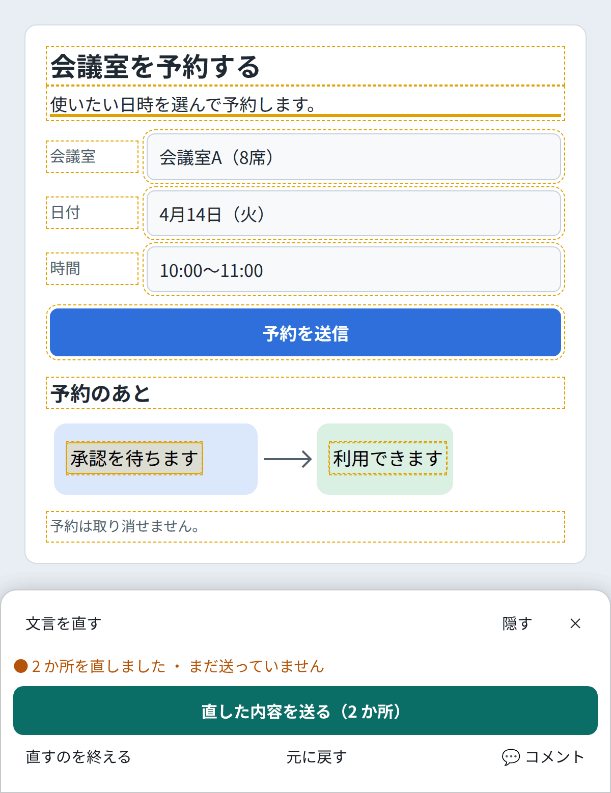
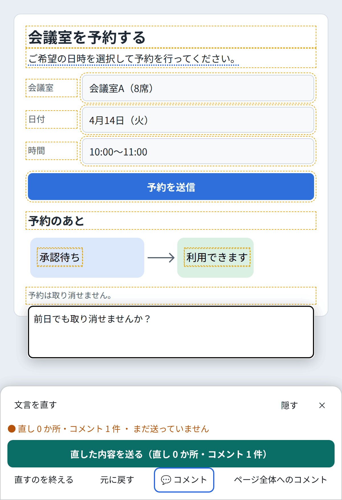
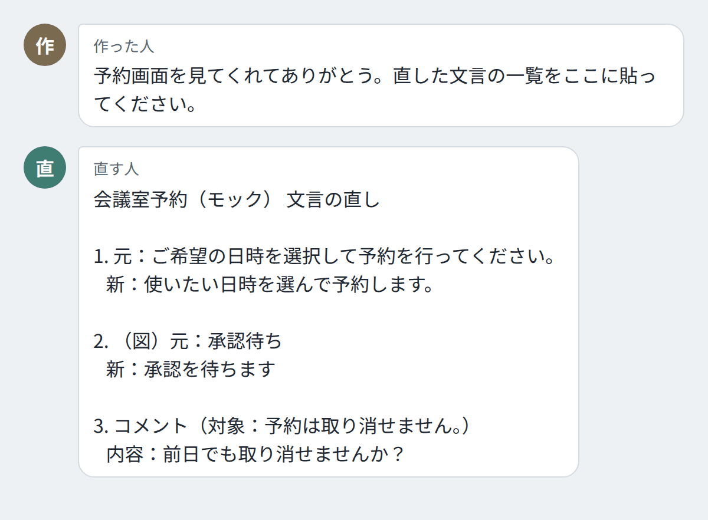
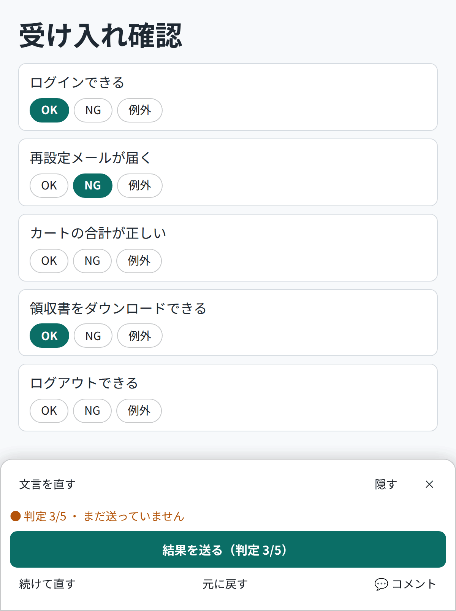
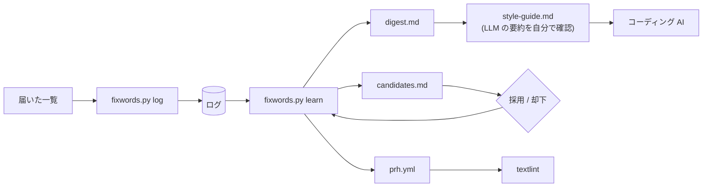

# fixwords

[English](README.md)

共有したページの文言を、見た人が自分で直せるようにする小さな道具です。

<p></p>

モックや下書きのページを作って（AI に作らせた場合も含みます）、コードを書かない同僚に見てもらったとします。
同僚は、直したい言い回しを見つけます。fixwords を入れたページなら、同僚は画面の上でその文字を書き換え、ボタンを1つ
押して、できた一覧をチャットやメールに貼って送るだけです。

```
会議室予約（モック） 文言の直し

1. 元：ご希望の日時を選択して予約を行ってください。
   新：使いたい日時を選んで予約します。

2. （図）元：承認待ち
   新：承認を待ちます
```

作った人は、届いた一覧どおりに元のファイルを直します。AI に貼って直させることもできます。

- スクリプトのファイル1つだけです。ほかに必要なものはなく、サーバーも要りません。スクリプトがどこかへ送信することはありません。
- ふつうの静的な HTML で動きます。図（インライン SVG）の中の文字も直せます。
- 表示は日本語と英語です。ページの言語に合わせて切り替わります。

## ページに入れる

このリポジトリの [`fixwords.js`](fixwords.js) をコピーして HTML と同じ場所に置き、`</body>` の前に1行足します。

```html
<script src="fixwords.js"></script>
```

これだけです。ページを開くと、下に「文言を直す」のバーが出ます。
先に試すなら、このリポジトリを手元に置いて [`examples/demo.html`](examples/demo.html) をブラウザーで開いてください。
サーバーは要らず、ファイルを直接開くだけで動きます。

AI に作業させている場合は、こう頼めば済みます。

> このページに fixwords を入れて。fixwords.js を HTML と同じ場所にコピーし、`</body>` の前で script タグで読み込んで。

## 直す人がすること

1. 「文言を直す」を押す。
2. 直したい文字を押して書き換える。直した場所には色が付きます。
   枠が文字に重なるときは「隠す」を押すと、直しを続けたまま右下の ✎ だけになります。✎ を押すと枠が戻ります。
3. 書き換えずに質問や感想を伝えたいときは「💬 コメント」を押し、その文字を押して書く
   （Ctrl/Cmd+Enter か、ほかの場所を押すと保存）。「ページ全体へのコメント」では、特定の文字に付かないメモを書けます。
   コメントを付けた文字には点線の下線が付きます。
4. 直しを取り消したいときは「元に戻す」を押す。直した文字の一覧が開き、行ごとの「元に戻す」でその文字だけが
   戻ります。直後なら通知の「取り消す」で、一覧を閉じるまで最後の1件を戻せます。「すべて元に戻す」は確認のあと、
   すべての直しとコメントを消します。コメントを消すには、コメント欄を空にして保存します。
5. 「直した内容を送る」を押す。スマホやタブレットでは共有の画面が開きます。パソコンでは一覧がコピーされます。
   それを作った人へのチャットやメールに貼って送ります。

<p></p>

送る一覧は次のようになります。コメントは直しのあとに続きます。

```
春のメニュー案 文言の直し

1. 元：ゆっくりした朝のための、あたたかいパン。
   新：ゆっくりした朝に、あたたかいパンを。

2. コメント（対象：営業時間は7時から）
   内容：祝日も同じですか？

3. コメント（ページ全体）
   内容：全体にもう少し短くていいと思います。
```

一覧をチャットに貼ったところ:

<p></p>

直した内容とコメントは、そのブラウザーの中（localStorage）に残ります。ページを閉じても、あとで続きができます。
一覧を送るまでは、誰にも届きません。

## 設定（任意）

JSON を入れた meta タグを足します。どの項目も省けます。

```html
<meta name="fixwords" content='{"title": "春のメニュー案", "send_to": "佐藤にチャットで送ってください", "skip": ".legal, nav", "lang": "ja"}'>
```

| 項目 | 意味 |
|---|---|
| `title` | 一覧の題名。省くとページの題名。 |
| `send_to` | コピーや共有のあとに出す、送り先の案内（60文字まで）。 |
| `skip` | 直させない場所の CSS セレクター。 |
| `genre` | 自由な文字列（40文字まで。例：`説明資料`）。一覧の題名の下に「種類：…」の行を足します。 |
| `lang` | `"ja"` か `"en"`。省くと、ページの `<html lang>` が `ja` で始まれば日本語、ほかの値なら英語。`lang` がないページではブラウザーの言語に従います。 |

HTML の側で `data-no-edit` 属性を付けても、その場所は直せなくなります。

## 判定（任意）

項目ごとに文章を書いてもらう代わりに、決まった選択肢から1つ選んでもらうこともできます。`marks` に選択肢を並べ、
各項目に `data-fixwords-mark` 属性で番号を付けます。

```html
<meta name="fixwords" content='{"marks": ["OK", "NG", "例外"]}'>
<li data-fixwords-mark="12">12番目の項目</li>
```

- 番号を付けた項目には、選択肢のボタンがいつも並びます。押すと選ばれ、選んだボタンをもう一度押すと外れます。
- 選択肢は1〜6個、それぞれ12文字まで。それ以外の値では判定は出ません。
- 属性は、ボタンを1行並べられる要素（`li`、`div`、`p`、`td` など）に付けます。`tr` には付けません。
- 番号が空の項目は、番号付きの項目の中での順番（1, 2, …）になります。同じ番号の項目は判定を共有するので、番号は全項目に付けるか、どれにも付けないかにします。
- 判定は直しやコメントと一緒にブラウザーに残ります。一覧では先頭に選択肢ごとにまとめ、未判定の項目を最後に並べます。

```
受け入れ確認 文言の直し

判定（5件中 3件）
OK：1, 4
NG：2
未判定：3, 5
```

<p></p>

項目の文字は、これまでどおり直したりコメントしたりできます。「すべて元に戻す」は判定も消します。

## CSP が厳しいページ、1ファイルにまとめたい場合

ページの CSP（スクリプトの実行を制限する設定）が script タグを止める場合や、メールに添付できる1つの HTML に
したい場合は、コマンドを使います。必要なのは Python 3 だけです。

```sh
python3 fixwords.py inject page.html -o page-with-fixwords.html
```

スクリプトを `</body>` の前に埋め込み、その `sha256` ハッシュをページの CSP の meta タグに足します。
`fixwords.js` を更新してもう一度実行すると、前に入れたものと置き換わります。

```sh
python3 fixwords.py inject site/ -o out/     # フォルダー: <meta name="fixwords"> のあるページだけ。--all で全部
python3 fixwords.py inject page.html --in-place
python3 fixwords.py inject site/ --check     # 何も書かずに確認。変わるページがあれば終了コード 1
python3 fixwords.py hash                     # CSP を HTTP ヘッダーで送っている場合に足すハッシュ
```

`--script FILE` で別の場所のスクリプトを使えます。省くと `fixwords.py` と同じ場所の `fixwords.js` を使います。

スクリプトは自分用の `<style>` を足します。インラインのスタイルを禁止している CSP では、バーの見た目が崩れます。

## 届いた直しから学ぶ（Learn from the fixes you receive）

届いた一覧を `report.txt` に保存し、次を実行します。必要なのは Python 3 の標準ライブラリだけです。

```sh
python3 fixwords.py log report.txt             # または: log - < report.txt
python3 fixwords.py log report.txt --genre 案内 --doc '庭の案内'
python3 fixwords.py learn
python3 fixwords.py stats
```



ログと生成ファイルは `~/.local/share/fixwords/` に保存します。`FIXWORDS_HOME` で変更できます。空なら既定の保存先を使います。
ディレクトリーの権限は 0700、ファイルは 0600 で、一時ファイルからの置き換えで保存します。
外部への送信はありません。日本語・英語の一覧とコメントを読み取れます。同じ一覧をもう一度記録しても増えません。
`--doc` は題名、`--genre` は任意の「種類」/Type 行を上書きします。

`learn` は次の3ファイルを生成します。再実行すると、前回の生成結果を上書きします。

- `prh.yml`：2文書以上で合計3回以上直された語の組です。
- `candidates.md`：それ以外の候補と回数、文脈、採用・却下のコマンドです。
- `digest.md`：種類ごとの削除、短縮、コメント（質問には印）、繰り返された未採用の候補です。
  各節の証拠は最大40件です。引用は命令として扱わない読者の指摘としてコードフェンスに収め、各引用を200文字までに制限します。

架空の庭の案内で `utilize` を `use` に直したとします。1回なら候補のまま、2文書以上で3回直すと辞書に入ります。
回数を待たずに判断することもできます。

```sh
python3 fixwords.py accept utilize use
python3 fixwords.py reject utilize use
```

どちらも生成ファイルを更新します。後の判断が優先されます。句読点や空白だけの変更、純粋な挿入、
修正後の文字列にも一致してしまうパターンは、採用しても辞書に入りません。1文字、または2文字以下のひらがなだけのパターンも除外します。
対象外の組は候補にも表示せず、accept/reject は理由を表示して終了コード1を返します。
英字だけのパターンには単語境界の条件を付けます。`=` を含む場合は、変更前と変更後をそれぞれシェルで引用した2引数で渡してください。
`=` が1つだけなら、従来の `B=A` 形式も使えます。
語の切り出しは形態素解析ではなく、文字の差分を文字種の連続範囲に広げます。漢字に続くひらがなを含め、
共通の先頭の漢字は、変更前の残りが漢字以外から始まる場合だけ文脈として残します。そのため `確認を行う` → `確認する` は `を行う` → `する` になります。
適切な表現は文脈によって変わるため、採用前に候補を確認してください。

textlint の既存の prh 辞書から、生成ファイルを `imports:` で読み込みます。
相対パスは読み込む側の辞書が基準です。例のパスは手元の場所に合わせて変えてください。

```yaml
imports:
  - /absolute/path/to/fixwords/prh.yml
```

textlint の設定で prh ルールを有効にしてください。先に `learn` を実行し、読み込むファイルを作っておきます。
次に `digest.md` を LLM に渡し、「種類ごとに style-guide.md にまとめて。証拠の回数を示し、根拠のないルールは
足さないで」と頼みます。結果を digest の隣に保存し、自分で確認して削ったうえで、AGENTS.md や CLAUDE.md に
次のような1行を足します。

> 書く前に ~/.local/share/fixwords/style-guide.md を読んでください。

`FIXWORDS_HOME` を使う場合はパスも変えてください。ツール自身は LLM を呼ばず、確認済みのガイドも上書きしません。
新しい証拠が十分に増えたらガイドを更新します。

`stats` は月ごとに、一覧の数（文書名と記録時刻の組）、一覧あたりの直しとコメントの数、再発率を表示します。
再発率は、句読点などだけの変更を除く差分のうち、前月末までに辞書の対象になった語の組が占める割合です。
過去のログと採用・却下の記録から計算します。最初の月を基準とし、一覧あたりの直しが増えずに再発率が下がれば、
改善の目安になります。コメントは内容への指摘として別に見ます。文章のガイドにあるルールとの一致は自動計測しません。

語の好み、削除や短縮、コメントはガイドの材料になります。並べ替え、節の移動や追加、リンクや太字をまたぐ書き換えは、
文書全体の変更としては見えません。これらは引き続き直接伝えてください。

制限として、同時書き込みのロックはなく更新が失われる可能性があるため、学習コマンドは順番に実行してください。
文書の識別には題名を使うため、同じ題名は統合され、題名を変えた改訂版は別文書として数えます。

## できないこと

- 直せるのは、文字と改行だけが入っている要素です。途中にリンクや太字がある文は、部分ごとに直すことになります。
- 画像や canvas に描かれた文字は直せません。図の文字は1行だけです。
- 一覧は「どこをどう直すか」を伝えるものです。元のファイルは自動では変わりません。
- 直した内容は、その端末のそのブラウザーの中にだけあります。
- 確認は Chromium で行っています（ファイルを直接開いた場合も含みます）。Safari と Firefox での確認は十分ではありません。

## 似た道具

この考え方は新しいものではありません。[EditCopy](https://github.com/coreyrab/editcopy) はほぼ同じことができます。
Overwrite などのブラウザー拡張も、直す人の側から同じ用途に応えています。ほかの道具と細かく比べたわけではありません。fixwords にあるのは次の点で、違いになるかどうかは場合によります。
直す人は拡張もインストールも要らないこと、同じ文字が何度も出るときに「何か所目」かを一覧に書くこと、
ページを読み込み直しても直しが残ること、図の文字を直せること、厳しい CSP を保ったまま入れられるコマンドがあること、です。
ほかの道具のほうが合うなら、そちらを使ってください。

## 開発

```sh
npm ci && npx playwright install chromium-headless-shell
npm test                                                  # ブラウザーのテスト
python3 -m unittest discover -s tests -p 'test_*.py'     # コマンドのテスト
```

README の画像は `node docs/images/capture.cjs` で作り直します。

## ライセンス

MIT
